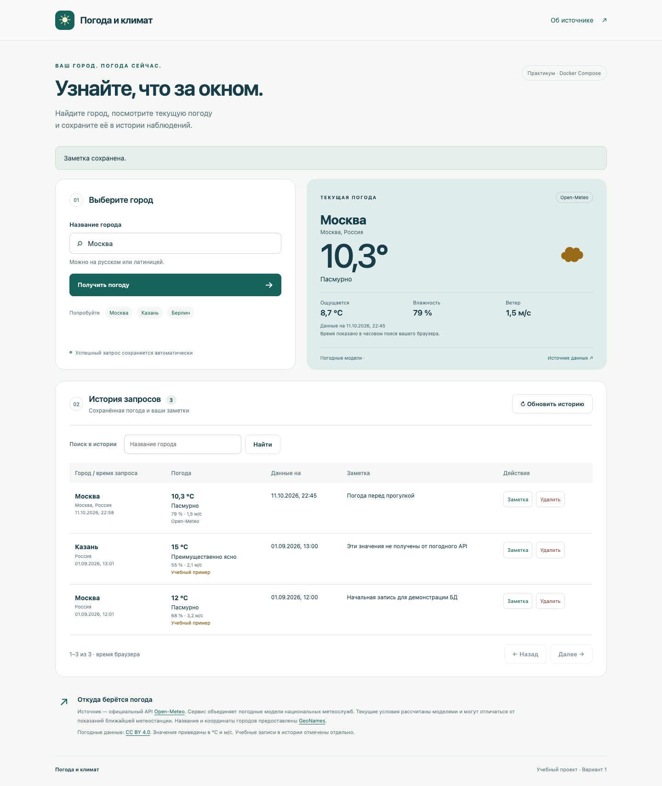

# Погода и климат

Лабораторный практикум «Контейнеризация многокомпонентных приложений с помощью Docker Compose». Вариант 1: текущая погода по названию города и история запросов.

**Если запускаете впервые на Kali Linux, начните с [пошаговой инструкции](docs/KALI_LINUX.md).** Там описаны установка Docker, распаковка, запуск, работа с приложением, проверка БД и решение ошибок.

## Быстрый запуск

Из каталога, в котором лежит `docker-compose.yml`:

```bash
sudo docker compose up --build -d
sudo docker compose ps
```

Последующие запуски: `sudo docker compose up -d`. Если Docker настроен для текущего пользователя, `sudo` можно убрать. Нужен современный Compose с командой `docker compose`.

| Что открыть в браузере Kali | Адрес |
| --- | --- |
| Пользовательский сайт | http://localhost:8080 |
| Страница Backend | http://localhost:8000 |
| Документация Backend | http://localhost:8000/docs |
| Страница погодного веб-сервиса | http://localhost:8001 |
| Документация веб-сервиса | http://localhost:8001/docs |

Ключ API и регистрация на погодном сайте не требуются. `.env` необязателен. По умолчанию используются учебные настройки; все опубликованные порты доступны только на самом компьютере. Приложение рассчитано на локальный практикум с общей историей, без учётных записей.

## Возможности

- Кнопка **«Получить погоду»**: поиск города, уточнение населённого пункта, запрос текущей погоды, автоматическая запись результата в PostgreSQL.
- Кнопка **«Загрузить историю»**: чтение записей из БД через Backend.
- Температура, ощущаемая температура, влажность, ветер, описание условий и время данных.
- История с поиском, страницами по 10 записей, заметками и удалением отдельных запросов.
- Обработка неизвестного города, задержек, недоступности источника и БД.
- Две начальные записи с явной меткой «Учебный пример». Они не выдаются за реальные данные API.



Снимок интерфейса во время проверки; значения на нём не являются актуальной погодой на момент просмотра.

## Архитектура

```text
Браузер → frontend (Nginx :80, снаружи :8080)
                 ↓ /api/*
             backend (FastAPI :8000)
                 ├─→ db (PostgreSQL :5432, именованный volume)
                 └─→ web-service (FastAPI :8001)
                               └─→ официальный API Open-Meteo (HTTPS)
```

Ровно четыре сервиса объявлены в одном `docker-compose.yml`: `frontend`, `backend`, `db`, `web-service`. Они используют одну сеть `weather-net` с драйвером `bridge`. Пятый контейнер не требуется: Open-Meteo — внешний источник данных. У БД есть `healthcheck`, зависимые сервисы ждут готовности. `weather-data` сохраняет историю между пересозданиями контейнеров. `db/init.sql` создаёт таблицу, индексы и начальные данные при первом запуске пустого volume.

Frontend написан на HTML/CSS/JavaScript без этапа сборки, Backend и отдельный погодный сервис — на Python 3.12 / FastAPI. Каждый прикладной компонент имеет собственный Dockerfile. Nginx передаёт `/api/*` Backend; поэтому браузеру не нужны адреса контейнеров или настройка CORS.

## Источник погоды

Используется **официальный API Open-Meteo**, а не парсинг сторонних страниц:

- [Документация погодного API](https://open-meteo.com/en/docs).
- [Поиск городов и GeoNames](https://open-meteo.com/en/docs/geocoding-api).
- [Лицензия CC BY 4.0](https://creativecommons.org/licenses/by/4.0/).
- [Условия бесплатного некоммерческого API](https://open-meteo.com/en/terms).

Open-Meteo объединяет погодные модели метеослужб. Это самостоятельный сервис, а не государственная метеослужба и не прямое измерение станции. На пользовательском сайте есть видимая атрибуция. Текущие условия основаны на моделях; время ответа и время погодных данных могут различаться. В БД время хранится с часовым поясом, интерфейс показывает время в часовом поясе браузера.

## Файлы проекта

```text
weather-compose/
├── docker-compose.yml
├── README.md
├── .env.example
├── .gitignore
├── frontend/          # сайт, Nginx, Dockerfile
├── backend/           # REST API, доступ к PostgreSQL, Dockerfile
├── web-service/       # адаптер Open-Meteo, Dockerfile
├── db/init.sql        # схема и начальные данные
├── tests/             # проверки API, ошибок и интеграции с БД
├── scripts/smoke.py   # сквозная проверка запущенного приложения
└── docs/
    ├── KALI_LINUX.md  # полная инструкция для новичка
    ├── ARCHITECTURE.md # API, структура БД и объяснение для защиты
    └── VERIFICATION.md # что проверено и что нужно проверить на Kali
```

Описание API и таблицы БД: [ARCHITECTURE.md](docs/ARCHITECTURE.md). Соответствие заданию и границы проведённых проверок: [VERIFICATION.md](docs/VERIFICATION.md).

## Проверки и остановка

```bash
# Требуется запущенный стек и доступ к Open-Meteo:
python3 scripts/smoke.py

# Логи и остановка с сохранением истории:
sudo docker compose logs --tail=100
sudo docker compose down
```

`smoke.py` создаёт проверочный запрос, читает и изменяет запись, удаляет только созданную им запись. Обычная история сохраняется. Полная инструкция также содержит ручную проверку сохранности данных после перезапуска.

Для сдачи разместите содержимое этого каталога в своём репозитории и внесите ссылку в таблицу группы по указаниям преподавателя. Действия в вашем аккаунте и таблице не выполняются автоматически.
